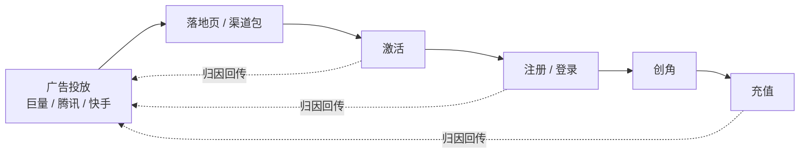
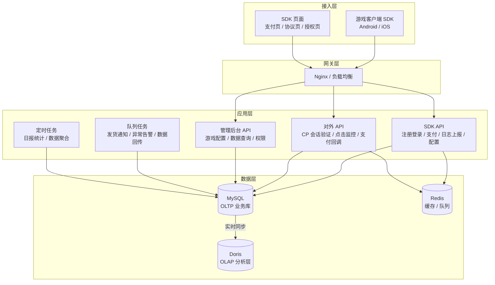
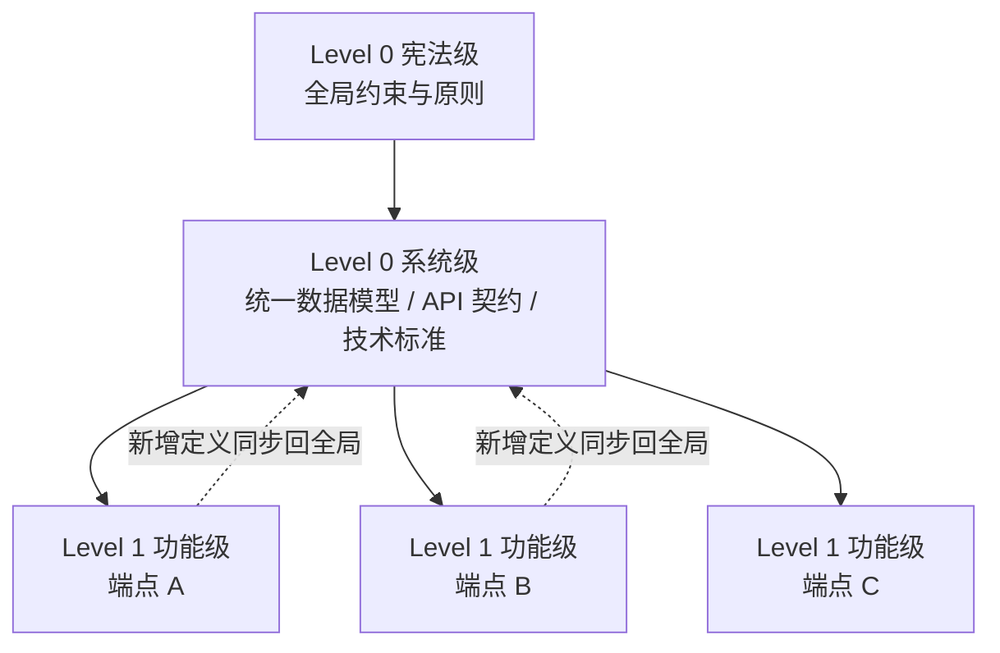

> 这个系列是我对「一套游戏发行技术平台该怎么设计」的完整梳理，基于我在游戏发行公司实际做过的系统整理而成（**已脱敏**，不含任何公司数据与配置）。
>
> 每章按四段展开：**业务背景 → 方案设计 → 关键取舍 → 真实经验**。最后一段是我实际踩过的坑，也是这份方案区别于模板的地方。
>
> 本篇是第一篇：**总体架构**。

---

## 一、业务背景

### 发行业务的技术链路

游戏发行不是「把游戏做出来」，而是「把游戏卖出去」。技术侧要支撑的是一条从投放开始的完整链路：

这条链路上，技术要解决四类问题：

| # | 诉求 | 为什么重要 |
|---|---|---|
| 1 | **低延迟** | 注册 / 登录接口直接影响转化率——用户多等一秒，可能就流失了 |
| 2 | **不丢不重** | 归因回传决定投放结算，少回传一条就是白花的钱，重复回传是脏数据 |
| 3 | **数据要快** | 投放团队要按天（甚至按小时）看 ROI 来调整计划，报表慢了就没意义 |
| 4 | **成本可控** | 发行公司技术团队通常很小，要的是「少组件、少运维」而不是「架构炫技」 |

另外还有一类刚性约束：**合规**。国内游戏必须做实名认证与防沉迷，这不是可选项。

### 一个关键的认知

发行系统的复杂度**不在并发量，而在业务链路的完整性**。

一家日活几千的发行公司，接口量可能只有每天几十万次请求——这个量级随便一台机器都扛得住。但链路上一环断了（比如支付回调没收到、归因没回传），业务就直接受损。

**所以设计的重心应该放在「链路完整、可追溯、可配置」，而不是「极限性能」。** 这个判断贯穿整个方案。

---

## 二、方案设计

### 2.1 系统分层

分层的核心思路：**业务接口和管理接口分开，交易和分析分开**。

- **SDK API** 面向玩家，要求低延迟、高可用；**管理后台 API** 面向内部运营，可以复杂查询但绝不能影响玩家侧
- **MySQL 扛交易，Doris 扛分析**——两者的查询模式完全不同，混在一套库里，报表一跑就把交易接口拖慢
- **Redis 同时承担缓存和队列**——规模没到需要独立消息中间件的程度，少一个组件就少一份运维成本

### 2.2 业务模块划分

系统按业务域拆成六个模块，每个模块有独立的文档入口和唯一的数据/接口源头：

| 模块 | 职责 | 关键设计 |
|---|---|---|
| **auth** | 登录、注册、SDK 初始化、游戏用户创建 | 游戏级用户 ID；注册 / 支付开关（可按游戏关闭） |
| **payment** | H5 支付、渠道路由、结算、原生内购与退款账本 | 多渠道可路由，后台可切换 |
| **attribution** | 广告点击追踪、归因匹配、转化回传 | 缓存优先归因，降低回传延迟 |
| **analytics** | 日报、ROI、留存、LTV、事实表 | 宽表事实表 + 分层报表 |
| **game-config** | 游戏开关、扩展配置、广告包、落地页 | 全部配置化，运营自助，不发版 |
| **admin-rbac** | 角色、权限、菜单树、数据权限 | RBAC + 数据域隔离 |

**这里有个容易被忽略的设计**：`auth` 和 `payment` 都挂了「游戏开关」——`disable_reg`、`disable_pay` 这类标记位。

为什么？因为发行运营中经常需要临时关掉某款游戏的注册或支付（版号问题、渠道问题、活动结束）。如果每次都要发版改代码，响应速度根本跟不上。**做成配置开关后，运营在后台点一下就能生效。**

### 2.3 规格驱动的设计方法

这是整套方案里我认为最有价值的部分。

系统有 17 个 API 端点（7 个日志上报、注册登录、支付、实名认证、广告等），如果每个功能各写各的，很快就会出现同名字段不同含义、重复定义、契约漂移。

所以采用了**分层规格约束**：

规则很硬：

1. **数据模型和 API 契约只能有一个源头**——一个 schema 文件 + 一份 OpenAPI 契约
2. **功能规格严禁定义新表、新接口**——只能引用全局定义，或扩展后同步回全局
3. **同步必须在实现之前完成**——不允许「先写代码，回头再补契约」

这条约束在多端点并行开发（尤其是有 AI 参与开发）时价值最大：**契约不漂移，多个实现才不会互相打架。**

### 2.4 技术选型

| 层 | 选型 | 选择理由 |
|---|---|---|
| 后端框架 | Laravel 11（PHP 8.2） | 生态成熟、开发效率高；配合常驻内存运行时解决 PHP 的性能短板 |
| 业务库 | MySQL 8.0 | OLTP 场景的标准选择，事务可靠 |
| 分析引擎 | Apache Doris | 列存 + MPP，适合宽表聚合；运维复杂度远低于自建 Hadoop 体系 |
| 缓存 / 队列 | Redis | 缓存和队列用同一套，少一个组件 |
| Web 服务器 | Nginx | JSON 格式访问日志，便于采集 |
| 管理后台 | React 18 + Vite + TDesign | 中台组件库，表格和表单场景开箱即用 |
| 客户端 SDK | Kotlin（Android）/ Swift（iOS） | 原生语言，渠道 SDK 对接友好 |
| 数据同步 | 云厂商 DTS 实时同步 | 业务代码零侵入 |

---

## 三、关键取舍

| 决策 | 选择 | 放弃的方案 | 理由 |
|---|---|---|---|
| **交易与分析** | MySQL + Doris 分离 | 一套库跑所有 | 报表聚合会拖慢交易接口，且分析查询不可控 |
| **数据同步** | 云厂商 DTS 实时同步 | 业务代码双写 | 双写要在每个写入点加代码，容易漏；同步是配置级的 |
| **事实表位置** | `*_facts` 只在 Doris | MySQL 也建一份 | 分析表放 OLAP，MySQL 不背这个包袱 |
| **消息队列** | Redis list | 独立消息中间件 | 当前规模不需要，少一个组件少一份运维 |
| **配置管理** | 游戏开关 + 扩展配置 | 每次改代码发版 | 运营自助，响应速度差一个数量级 |
| **日志策略** | 全量请求 / 响应审计 | 只记错误日志 | API 业务「请求过了就什么都没有」，日志是唯一现场 |
| **错误码** | 分段编码（1xxx 认证 / 2xxx 参数 / 3xxx 业务 / 4xxx 权限 / 5xxx 系统） | 单一通用错误码 | 客户端能按段做统一处理，定位更快 |

**关于「不用独立消息中间件」这个取舍值得多说一句**：这不是说 Redis 队列比专业 MQ 好，而是说**在日活几千的规模下，多引入一个组件的运维成本大于它带来的收益**。如果哪天量级上来了，换成专业 MQ 只是替换队列驱动，不影响业务代码结构。

---

## 四、真实经验

设计做完不算完，这几条是实际做下来才真正体会到的：

### 1. 契约先行不是形式主义，是并行开发的前提

一开始觉得「先写文档再写代码」拖节奏。但端点数量一多（再加上 AI 参与编码），问题立刻暴露：同一个概念在两个端点里字段名不一样、同一个字段两处定义类型不同。

把 schema 和 API 契约定为唯一源头之后，**冲突基本消失**——因为所有人都只能从同一个地方取定义。这个约束对 AI 辅助开发尤其重要：AI 不会「记得」上一次的约定，但会严格按你给的契约写。

### 2. 审计日志要一开始就做，不能事后补

后期的日志最大的问题是**串不起来**：出了问题想看「这个用户从请求到落库发生了什么」，结果发现关键路径没有统一的 request_id。

所以正确的做法是一开始就强制：所有接口带 request_id，请求参数和响应数据全量落 JSONL 审计文件。**代价是存储和一点性能，收益是任何业务问题都能回溯。**

### 3. 「同步」比「双写」省事得多

最早考虑过业务写入时双写分析库，后来改成数据库层实时同步。差别很大：

- 双写：每个业务写入点都要加代码，漏一处就是数据不一致，且事务边界很难处理
- 同步：配置级，业务代码零侵入，出问题只查同步链路

**能用基础设施解决的问题，不要用业务代码解决。**

### 4. 配置化是小团队的救命稻草

发行运营的需求变化极快：今天要关某款游戏的注册，明天要切支付渠道，后天要上新的落地页。

如果这些都走「提需求 → 开发 → 测试 → 发版」，一个需求就是几天。做成配置后，运营自己就能搞定。**小团队的人力，必须花在真正需要写代码的地方。**

---

## 下一篇

**（二）发行 SDK 接入层**：账号体系、多端登录、支付链路、实名认证与防沉迷的设计。

---

*本文基于实际项目整理，已脱敏。文中不含任何公司业务数据、配置或凭据。*
