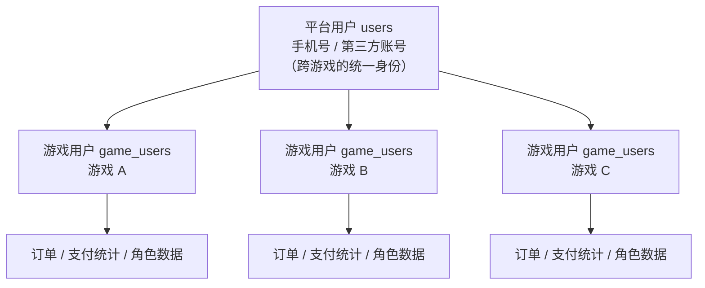
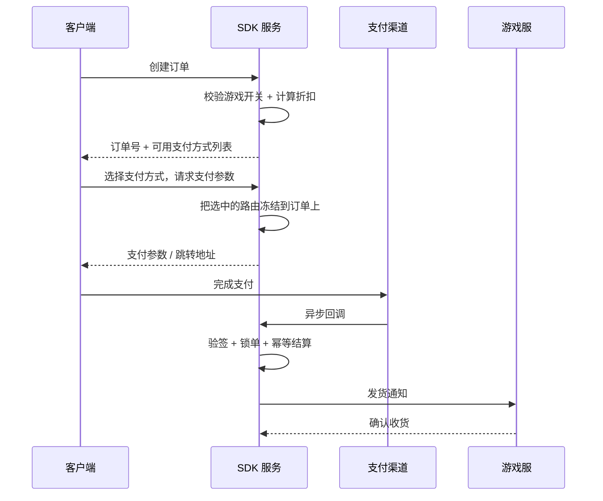

> 系列第二篇。第一篇讲整体骨架（[总体架构](/2026/10/13/game-publish-platform-01-architecture.html)），这一篇进入第一个核心模块：**SDK 接入层**。
>
> 同样四段：**业务背景 → 方案设计 → 关键取舍 → 真实经验**。

---

## 一、业务背景

### SDK 接入层是什么位置

游戏客户端要接入发行平台，靠的是一个 SDK。玩家侧看不到它，但所有关键动作都从这里经过：

- **登录注册**：一键登录、验证码、第三方账号（TapTap / Apple / 抖音小游戏）
- **支付**：拉起支付、回调结算
- **日志上报**：激活、登录、创角、升级、在线时长
- **合规**：实名认证、防沉迷

对玩家来说，这一段必须「无感」——登录要快，支付要顺。对发行方来说，这一段必须「可控」——出了问题能定位，运营要能调整。

### 核心矛盾

设计 SDK 接入层时，最根本的矛盾是：

> **游戏侧希望它简单（一个 SDK 接进去就能用），平台侧必须复杂（要同时服务多款游戏、多个渠道、多个支付方式）。**

如果按游戏的需求做设计，很快会变成「每接一款游戏改一次代码」；如果按平台的需求做设计，又容易把游戏侧拖进不必要的复杂度。

这个矛盾决定了下面几乎所有设计。

---

## 二、方案设计

### 2.1 两级身份模型（这是整个设计的地基）

第一件事是把「用户」拆成两层：

- **平台用户**（`users`）：跨游戏的统一身份，一个手机号或一个第三方账号对应一条记录
- **游戏用户**（`game_users`）：每个游戏一份，承载这个游戏内的登录状态、支付统计等

**为什么必须分两层？**

如果只有一层（一个游戏一个账号），玩家换游戏要重新注册，体验差；而且同一家公司的多款游戏之间无法做跨游戏运营。

如果只有一层（一个平台账号打通所有游戏），又会有问题：某个游戏因为版号或渠道原因要关闭注册，不能影响这个玩家在其他游戏的登录。

分两层之后，**开关可以按游戏粒度精确控制**——这才是关键。

### 2.2 游戏级开关：把运营动作从发版里解放出来

接入层最重要的一组字段，是游戏级的开关标记位：

| 开关 | 作用 | 边界（很重要） |
|---|---|---|
| `disable_reg` | 阻止在该游戏**创建新的游戏用户** | **不阻止已有游戏用户登录** |
| `disable_pay` | 阻止在该游戏**创建新订单** | 不阻止已有订单的查询与支付完成 |
| `disable_login_by_password` | 客户端隐藏账密登录入口 | 只是客户端门禁，服务端不硬拦 |
| `disable_real_person_cert` | 客户端隐藏实名入口 | 同上 |

**这几个开关的边界设计得对不对，直接决定运营会不会踩坑。**

举个具体的：`disable_reg` 是「关注册」，不是「关游戏」。老玩家必须还能正常登录——如果实现成「关游戏」，一次开关操作就会导致全服玩家无法进入，这是事故级别的错误。

所以正确的实现位置是在**「创建游戏用户」这个动作上**做闸门，而不是在登录接口的入口做拦截。所有登录路径（密码、验证码、一键登录、Token、第三方）最终都会走到同一个「获取或创建游戏用户」的方法，闸门设在那里，一处生效、处处生效。

同理，`disable_pay` 只拦「创建订单」，不拦「查询订单」和「支付回调」——否则运营一关支付，正在付款的玩家就会卡在半路。

### 2.3 多端登录的统一抽象

接入层要支持多种登录方式，但**不能让每种方式各写一套逻辑**：

| 方式 | 说明 | 特殊点 |
|---|---|---|
| 密码 | 账号密码注册登录 | 基础方式 |
| 手机验证码 | 短信登录/注册一体 | 未注册自动注册 |
| 运营商一键登录 | 免验证码 | 依赖运营商网关 |
| Token 自动登录 | 已登录态续期 | 可能需要在另一个游戏首次创建游戏用户 |
| TapTap | 第三方 OAuth | 需要处理跨游戏的账号续接 |
| Apple 登录 | Sign in with Apple | 需要验证 identityToken |
| 抖音小游戏 | 小游戏平台账号 | 独立注册流程，但受同一套开关约束 |

**统一抽象的做法**：每个方式只负责「验证凭据 → 得到平台用户」，剩下的「获取或创建游戏用户 → 签发登录态」全部复用同一个基础流程。

这样带来的直接好处是：**新增一种登录方式，不需要重新思考注册闸门、新用户判定、游戏用户创建这些逻辑。**

### 2.4 支付链路

支付是接入层最复杂的部分。完整链路：

这里面有几个关键设计：

**① 多支付渠道 + 路由可配置**

支付方式不是一个固定列表，而是按游戏配置的：微信 H5、支付宝 H5、抖音 H5，还可以绑定自有商户号直连。

每个游戏可以配置自己的渠道和账号绑定关系。**这样一款游戏的支付出问题，不会波及其他游戏。**

**② 路由必须冻结在订单上**

这是我认为最关键的一条：

> **下单时选定支付方式后，把这个路由快照写到订单上（支付方式 + 支付账号）。后续的回调验签和结算，一律以订单快照为准，不去读游戏当前的配置。**

为什么？因为配置是会变的。运营在玩家下单之后、回调到达之前改了支付配置——如果结算时读的是最新配置，就会出现「订单用 A 账号下单，却拿 B 账号的密钥去验签」，验签必然失败，玩家已经付了钱但订单结算不了。

**③ 幂等靠数据库唯一约束，不靠应用层判断**

第三方支付回调可能重复到达（渠道重试机制）。防止重复入账的做法不是「先查一下有没有处理过」，而是**在订单表上对第三方交易号加唯一约束**——重复回调会直接被数据库拦下。

应用层判断有竞态：两个回调同时到达，都查到「还没处理」，就都去入账了。数据库唯一约束是原子的。

**④ 结算时锁单**

回调结算走「悲观锁 + 状态机」：锁定待支付订单 → 校验状态 → 标记已支付 → 触发发货。锁保证同一订单不会被并发结算。

**⑤ 退款不碰订单账本**

这是 Apple 内购（IAP）接入时的一个关键决策：

> **退款只写退款记录表，不改订单状态、不减支付统计、不回滚发货。**

原因：订单账本记录的是「交易事实」，退款是「事后对账事件」，两者混在一起会让所有基于订单的统计口径失真。退款单独记表，需要净收入时用订单减去退款，**口径清晰、可追溯**。

### 2.5 实名认证与防沉迷

国内游戏的刚性要求，设计上有两个要点：

1. **实名状态由平台统一管理**，不交给各游戏自己存
2. **实名入口可以按游戏开关**（`disable_real_person_cert`），但开关只影响客户端是否展示入口，不影响服务端的校验逻辑

---

## 三、关键取舍

| 决策 | 选择 | 放弃的方案 | 理由 |
|---|---|---|---|
| **身份模型** | 平台用户 + 游戏用户两级 | 单级账号 | 单级无法按游戏粒度做开关；换游戏也要重新注册 |
| **注册闸门位置** | 放在「创建游戏用户」动作上 | 放在登录接口入口 | 入口拦截会连老用户一起挡住 |
| **支付路由** | 冻结到订单快照 | 结算时读实时配置 | 配置变更会导致回调验签失败、订单无法结算 |
| **幂等实现** | 数据库唯一约束 | 应用层先查后写 | 应用层判断有竞态，并发回调会重复入账 |
| **退款处理** | 只写退款表，离线对账 | 改订单状态、回滚统计 | 混在一起会让所有订单口径失真 |
| **客户端开关** | 只做展示门禁 | 服务端硬拦截 | 有些开关（如隐藏账密登录）是产品策略，不是安全边界 |
| **测试支付** | 独立标记，不进统计 | 混在真实订单里 | 测试数据污染统计口径，且难以回溯清理 |
| **渠道账号可用性** | 账号级开关 + 路由级覆盖两层 | 单一开关 | 账号故障要整体下线，单路由故障只需局部替换 |

---

## 四、真实经验

这一节的每一条，都是实际踩过或者差点踩到的：

### 1. 「平台用户」和「游戏用户」混淆，是最容易出 bug 的地方

举个典型的：接口返回一个「是否新注册」的标记。这个标记指的应该是**当前游戏的游戏用户是否新建**，而不是平台用户是否新建。

差别在哪？一个老玩家第一次进入新游戏——平台用户是老的，但游戏用户是新的。如果按「平台用户是否新建」来判断，就会把这个玩家当成老用户，新手引导、首充礼包这类逻辑全部失效。

**两级身份模型的代价就在这里：所有涉及「新/老」的判断，都必须明确说的是哪一级。** 这个认知要在团队里反复强调，否则每加一个功能都可能踩一次。

### 2. 第三方登录的身份键，选错了会非常痛

Apple 登录有个坑：它可能返回一个「私有转发邮箱」（private relay email）而不是真实邮箱。

**这个邮箱不能用来做身份键**——因为它是按 App 生成的，而且会轮换。如果拿它当用户标识，某天邮箱变了，这个用户就登录不上了。

正确做法是用 Apple 提供的稳定用户标识（`sub` 字段）作为身份键，邮箱只作为资料存储。

同样的道理适用于所有第三方登录：**要找那个「平台保证不变」的字段做身份键，而不是看起来最像用户名的那个。**

### 3. 第三方密钥的缓存，必须考虑轮换

验证第三方登录凭据（比如 Apple 的 identityToken）需要对方的公钥。公钥会定期轮换，所以：

- 缓存必须有 TTL（不能永久缓存）
- 缓存失效时要能刷新（按 key id 未命中时主动拉取）
- 刷新要防击穿（同一时刻大量请求同时发现缓存失效，会一起打向第三方接口）

**如果只做了最简单的「启动时拉一次并缓存」，那么对方轮换密钥的那一天，所有登录会同时失败。** 这类故障的特点是：平时完全看不出来，一出就是全量。

### 4. 支付统计口径要在设计时就定死

哪些订单算「有效支付」？这个问题的答案必须在设计阶段明确，否则后期对账永远对不平。

明确下来的是：

- 只有支付成功的订单计入
- 测试支付的订单不计入
- 零元订单（如广告激励发放）不计入

**统计口径是业务规则，不是技术细节**——它应该写在契约里，而不是散落在各个统计查询里。

### 5. 第三方回调端点不要混在一起

支付回调有两种来源：一种是渠道的交易完成回调（订单维度），另一种是平台的生命周期事件通知（如退款）。

一开始容易把两者放在同一个端点下，靠渠道参数区分。但它们的**验签方式不同、白名单不同、处理逻辑完全不同**，混在一起会出现路由遮蔽和校验错配。

**分开两个端点，各自独立验签。** 端点数量多一点不是问题，混淆带来的排查成本才是问题。

---

## 下一篇

**（三）打包与分包**：投放分包（包内嵌投放计划 ID 做归因）、渠道分包、iOS 私域分发的设计与取舍。

---

*本文基于实际项目整理，已脱敏。文中不含任何公司业务数据、配置或凭据。*
