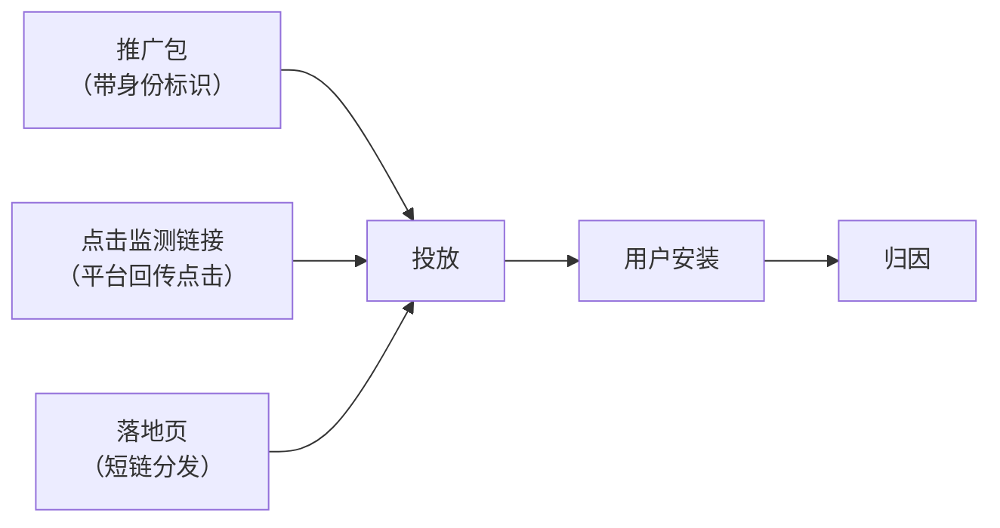
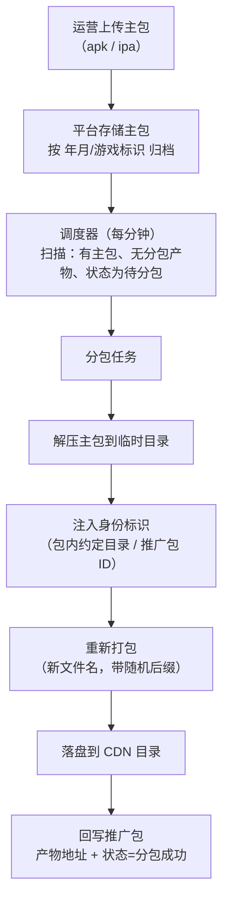

> 系列第三篇。上一篇讲接入层（[SDK 接入层](/2026/10/13/game-publish-platform-02-sdk-access.html)），这一篇讲发行平台最"重"的一块：**包**。
>
> 依然四段：**业务背景 → 方案设计 → 关键取舍 → 真实经验**。

---

## 一、业务背景

### 为什么发行平台要自己管分包

买量投放有个基本前提：**投出去的钱要能追回来**。

广告平台给的是一个计划 ID，用户从某个计划点进来、下载、注册、付费——这条链路必须能对上。对不上的直接后果是：不知道该加哪个计划的预算，也不知道哪个计划在亏钱。

所以投放需要的不是"一个安装包"，而是**一个计划一个包**——包里带着这个计划的身份，客户端装上之后能报出来"我是从哪个计划来的"。

渠道合作是同一个问题的另一种形态：不同渠道要分开统计、分开结算，也需要渠道包。

再加上 iOS 不能走公开商店的场景，需要**私域分发**（企业签名 + 网页安装）。这三件事加起来，就是"打包与分包"这个模块要解决的：

| 需求 | 包的类型 | 归因对象 |
|---|---|---|
| 买量投放 | 投放分包 | 广告计划 |
| 渠道合作 | 渠道分包 | 渠道 |
| iOS 私域 | 私域分发包 | 计划 / 渠道 |

### 包不是孤立的交付物

这是做发行平台才会有的体感：**包只是投放三件套之一**。



- **推广包**：带身份标识的安装包
- **点击监测链接**：用户点击广告时，广告平台回调我们，我们把这次点击存下来（点击记录里带着设备标识），后面用户激活时用来匹配
- **落地页**：投放的承接页，短链分发，页面上的下载按钮指向这个包

三者都挂在同一个"推广包"对象上（一个 `adv_id` 串起来），所以数据模型里它们是同一张表加两张关联表，而不是三个独立系统。

### 核心矛盾

> **运营一天要开几十个包，手动出包根本跟不上；但把出包搬到服务端，就意味着"构建"这件事进了线上系统——慢、重、还可能失败。**

慢、重、会失败，这三件事决定了后面所有的设计。

---

## 二、方案设计

### 2.1 推广包模型

核心表是推广包（`adv_packs`），关键字段：

| 字段 | 说明 |
|---|---|
| `gid` | 归属的游戏（子游戏粒度，因为不同平台要出不同的包） |
| `adv_type` | 推广方式：自然量 / 信息流 / CPS 分包 / CPS 星图 / 抖音直播 |
| `adv_plan_name` | 广告计划名称（下面单独讲，这是全表最严格的字段） |
| `adv_pack_url` | 包文件地址（分包产物） |
| `adv_click_monitor` | 点击监测链接 |
| `status` | 分包状态机 |

**`adv_plan_name` 为什么是全表最严格的字段**

它不是"给运营看的名字"，而是**对账键**——必须与广告平台上的 Campaign Name 完全一致，因为它要参与"平台数据 vs 我们数据"的逐计划对账。

所以约束是三层叠加的：

- 存储前去除首尾空白
- 值中不允许出现任何空白字符（含中间空格）
- 全表唯一，业务校验 + 数据库唯一索引双重保证

**把业务键当普通文本字段存，是这类系统最常见的技术债。** 一旦库里出现"计划名 A "和"计划名 A"两条，对账就永远对不平。

**自然量包是自动生成的**

每个子游戏创建时，系统自动生成一个自然量包（名称格式含游戏标识 + gid + "自然量"），它豁免上面那条 Campaign Name 匹配规则——因为自然量本来就没有投放计划。

它的作用是兜底：用户不是从广告进来的，激活时匹配不到任何计划，就归到自然量包上。**没有这个兜底，"未归因"就会变成一个到处都要特殊处理的分支。**

### 2.2 分包流水线

主包（每个子游戏上传一份）→ 分包任务 → 推广包，整条流水线：



几个关键设计：

**① 注入的是包内目录，不是配置文件，也不依赖接口下发**

分包时在包里生成一个约定目录（渠道 SDK 约定位置），目录名就是推广包 ID。

为什么不做成"启动时调接口拿计划 ID"？因为**安装完第一次启动时网络不可靠**，而且接口方案意味着"分包"退化成一个配置动作，包本身不带身份——一旦接口挂了或请求失败，这个用户就永久丢失归因。**身份必须在包里，装到机器上就是确定的。**

**② 文件名即身份，随机后缀即缓存失效**

分包产物文件名格式：

```
{游戏标识}_{gid}_{adv_id}_{adv_type}_{创建人}_{4位随机后缀}.apk
```

中间那段是身份，最后 4 位随机十六进制是**缓存击穿**用的：

> CDN 时代的铁律：**改了内容不改文件名，等于没改。** 重新分包必须产生一个新的 URL，否则 CDN 节点上还是旧包。

代价是旧包永远保留（不删除）——存储成本换可回溯性，这个账在发行场景是划算的：一个包才多大，但"这个计划当时投的是哪个包"是要能查的。

**③ 状态机要能区分"排队"和"失败"**

分包状态：无需分包 / 没有主包 / 待分包 / 分包中 / 分包成功 / 分包失败。

**"待分包"这一档是后补的，补它的原因值得记一下**：最初没有这一档，重新分包的做法是把状态改成"分包失败"，让调度器捡起来。功能上能跑，但语义上是污染的——运营看到"失败"会去排查，技术排查日志时也分不清是真失败还是排队中。

**用错误状态当队列占位，是所有状态机设计里最容易犯又最容易被容忍的错误。** 它不会报错，只会让所有看状态的人（包括未来的自己）判断失真。

### 2.3 异步生命周期与运营体验

分包是分钟级的操作（解压 + 打包 + 落盘），前端如果只弹个"成功"toast，运营会以为卡住了。

所以分包状态在前端是一等公民：

- 列表页有**状态列**，一眼看到每个包在哪个阶段
- 页面级说明：明确告知"iOS 私域分包是异步的，通常需要 1-5 分钟"
- **有活跃任务才轮询**（10-15 秒一次），全部到终态自动停止——不给后端制造无意义的空转
- 处理中的行，**"重新分包"按钮禁用**——防止运营连点造成重复排队

这套做法没有用 WebSocket，也没有做假的百分比进度条。**诚实的阶段状态 + 自动刷新，比一个猜出来的进度条有用得多。**

### 2.4 iOS 私域分发

iOS 私域（企业签名）的分发链路和 Android 完全不同：


技术要点是 `itms-services://?action=download-manifest&url={清单地址}` ——iOS 通过这个协议从网页触发安装，清单文件里写明 IPA 的下载地址。

**这里有一个去掉异步阶段的设计**：

最初清单文件是"生成出来的"——分包完成后，再跑一个任务生成 plist 文件存起来。但仔细看它的内容：**清单里所有信息都是确定的**（游戏名、包标识、IPA 地址），完全可以按 `adv_id` 实时渲染出来。

于是改成动态路由：`/p/plist/{adv_id}`，按需返回清单内容。

收益连锁反应：清单生成任务删掉、清单状态字段删掉、清单路径字段删掉，**用户可见的异步阶段从三个减到两个**（等待 / 分包中 → 就绪或失败）。**重新分包后，清单自动指向新包，不需要任何额外动作。**

**"这个中间产物是否必要"这个问题，值得在每个异步环节问一次。** 很多异步阶段不是因为真的需要时间，而是因为第一步就把它设计成了"文件"。

### 2.5 落地页

落地页是投放的承接页，设计上两个决定：

**① 模板 + 实例分离**

- 模板（`landing_page_templates`）：HTML 内容，用占位符标记变量，必须包含游戏名和下载链接两个占位符
- 实例（`landing_pages`）：关联某个推广包，生成短链

**② 动态渲染，不做静态快照**

早期做法是"生成一个静态 HTML 文件存到 CDN"。后来改成**实时拉最新的模板 + 最新的推广包 + 最新的游戏数据渲染**。

为什么？因为静态快照的维护成本极高：改了模板要重新生成所有页面；推广包重新分包后，旧页面上的下载链接还是老包。**动态渲染让"改模板"和"重新分包"这两个动作对落地页零成本。**

短链（`/p/{短码}`）指向渲染服务，天然跟着数据走。

### 2.6 渠道分包

渠道分包和投放分包的区别不在技术，在**归因对象**：投放分包归因到"计划"，渠道分包归因到"渠道"。

国内 Android 渠道的碎片化是历史问题：每家渠道有自己的 SDK、自己的登录和支付、自己的统计口径。**渠道分包的实际做法是走聚合 SDK**——由聚合层屏蔽各渠道差异，我们只对接聚合层一套接口，出包时注入渠道参数。

设计上的取舍是：**不自建渠道适配层**。渠道适配是个持续维护的黑洞（每家的 SDK 都在更新），把这部分交给聚合层，平台侧只维护"渠道 → 包 → 数据"的映射关系。**平台的价值在于数据和归因，不在于复刻一遍渠道 SDK。**

---

## 三、关键取舍

| 决策 | 选择 | 放弃的方案 | 理由 |
|---|---|---|---|
| **出包位置** | 服务端自动分包 | 运营本地手工出包 | 手工出包无法保证身份标识正确，且不可追溯、不可重放 |
| **身份注入方式** | 包内目录 | 启动时接口下发 | 首次启动网络不可靠，接口挂了就永久丢归因 |
| **缓存处理** | 文件名加随机后缀 | 刷新 CDN 缓存 | 加后缀对 CDN 无感，且旧包天然保留可回溯 |
| **旧包清理** | 永久保留 | 定期删除 | 存储成本低，"当时投的是哪个包"必须可查 |
| **清单文件** | 动态路由渲染 | 生成 plist 文件存储 | 内容完全确定，异步阶段是自找的 |
| **落地页** | 动态渲染 | 生成静态 HTML | 静态快照改模板要全量重生成，分包后链接还会失效 |
| **状态机** | 显式"待分包"状态 | 复用"失败"状态当队列 | 语义污染会让运营和排查同时失真 |
| **渠道适配** | 走聚合 SDK | 自建渠道适配层 | 渠道 SDK 持续变化，维护成本是无底洞 |
| **计划名约束** | 全表唯一 + 禁空白 | 当普通文本存 | 它是对账键，脏数据直接导致对账对不平 |

---

## 四、真实经验

这一节是这一章最值钱的部分——分包踩的坑，几乎全是"和操作系统打交道"的坑。

### 1. 用 zip 打 IPA，参数选错会直接毁掉包结构

打包 iOS 的 IPA，最初尝试了几种 zip 参数组合，全部失败：

- 加了 `-j`（丢掉目录结构）→ 报 "cannot repeat names in zip file"
- 从目录外直接指定路径压缩 → 报 "Nothing to do!" 或 "I/O error: Invalid argument"

正确写法是三条一起：

```bash
cd /tmp/tempdir && zip -q -r -0 /tmp/output.ipa .
```

- **不要 `-j`**：IPA 的 `Payload/` 目录结构是格式的一部分，剥掉就不是 IPA 了
- **先 `cd` 进目录**，源写 `.`：从目录内部压缩，而不是从外部指定路径
- **`-0` 不压缩**：IPA 内部已经是压缩过的资源，再压缩没收益，还会引入扩展属性问题

**这类问题的特点是：报错信息完全看不出原因，只能靠理解格式本身。** 知道"IPA 是带目录结构的 zip"这件事，比记住参数重要。

### 2. 跨文件系统的 rename 会失败，而且 PHP 和 shell 的行为不一样

分包流程里要把产物从临时目录搬到 CDN 目录，代码用 `rename()` 直接报：

```
rename(/tmp/xxx.ipa, /data/uploads/...): Operation not permitted
```

排查发现这不是权限问题，是**内核层面的限制**：

- `/tmp` 在本地文件系统上
- CDN 目录是对象存储的 FUSE 挂载
- POSIX 规定 `rename()` **不允许跨文件系统**（返回 `EXDEV`）

更有意思的是**为什么 shell 的 `mv` 是好的**：

> shell 的 `mv` 检测到 `EXDEV` 会自动降级成"复制 + 删除"；而 PHP 的 `rename()` 直接调系统调用，**没有任何降级**。

所以解决方案是显式地做这件事：

```php
exec("cp '{$src}' '{$dst}' && rm -f '{$src}'", $output, $ret);
```

**同一个操作，命令行和语言的语义不同——这类差异在"脚本里能跑、代码里不行"的场景下，往往就是这个原因。**

### 3. 系统用户的"没有 shell"会以很奇怪的方式暴露

分包调度挂在系统 cron 上。第一次部署时 cron 报 `flock: command not found`——但服务器上明明装了 flock。

原因：任务要以 web 用户身份运行，而**这个用户被配置成没有登录 shell**，cron 直接执行命令时找不到 PATH。

解法是用 shell 包一层：

```
sudo -u {web用户} /bin/sh -c '...'
```

**"命令不存在"报错的第一反应不该是"没装"，而是"这个上下文里 PATH 是什么"。** 换一个执行上下文（cron、systemd、sudo）就换了一套环境，这是部署类问题的通用规律。

### 4. 大文件上传的限制有三层，少配一层就是 413

上传主包（IPA/APK 动辄几百 MB）时遇到 413，最后发现要三层一起放开：

- nginx 的 `client_max_body_size`
- PHP 的 `post_max_size` 和 `upload_max_filesize`
- 应用层对上传大小的校验

**任何"传大文件"的需求，都要先把这三层数一遍。** 只改一层，报错还会以别的形式回来。

### 5. "失败"不能当"排队"用

前面提过一次，这里再强调：重新分包最初是靠把状态改成"分包失败"来触发调度器重扫的。

它带来的实际成本是：运营看到失败会来问、技术排查时要先去翻日志确认是哪种"失败"。**一个状态的语义被复用，所有读它的人就都多了一次判断成本。** 补一个"待分包"状态的成本，远低于长期让所有人多问一句"这个失败是真的还是排队"。

### 6. 改了内容不改名字，等于没改

这条是分包带出来的通用规律，值得单独记：

**在 CDN 面前，URL 就是缓存键。** 重新生成产物必须换 URL，否则用户拿到的是旧内容，而且这个问题**在你的机器上永远复现不出来**——只有 CDN 边缘节点上才有旧副本。

所以产物文件名里带了随机后缀，每一次生成都是新 URL。副作用是文件会累积，但配合"按年月归档"的目录结构，管理和回溯都不成问题。

---

## 下一篇

**（四）数据体系**：事件模型、宽表设计、分层报表、归因回传——包和点击数据进来之后，怎么变成能指导投放决策的数据 → [继续阅读](/2026/10/13/game-publish-platform-04-data-system.html)

---

*本文基于实际项目整理，已脱敏。文中不含任何公司业务数据、配置或凭据。*
