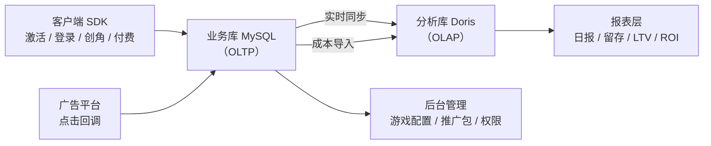
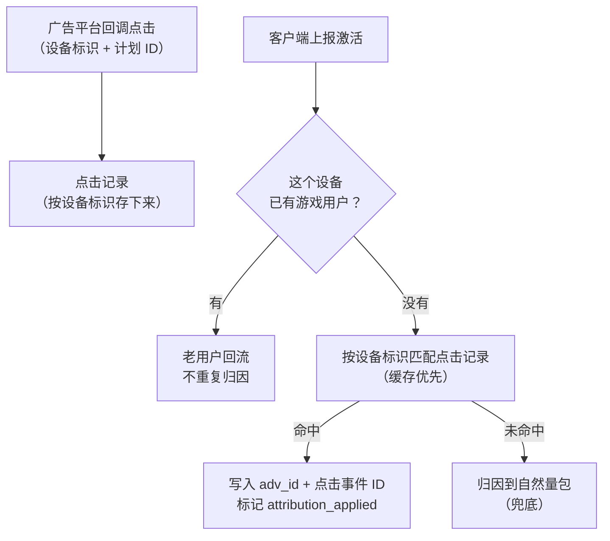
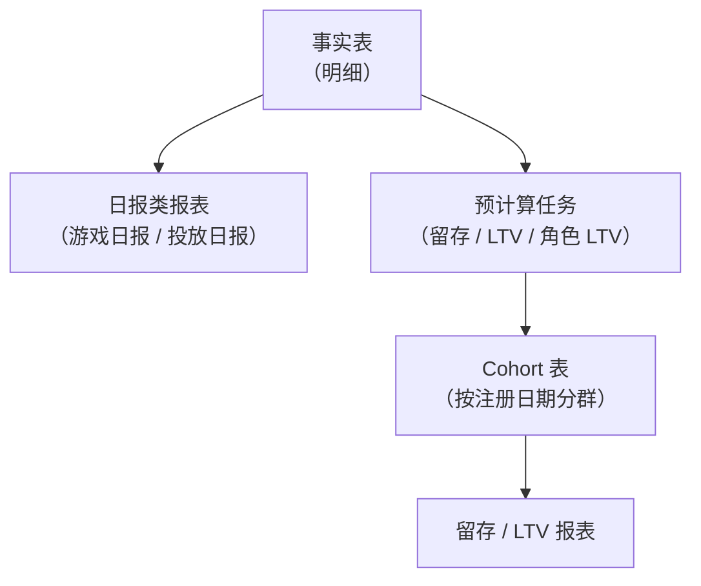

> 系列第四篇。上一篇讲包（[打包与分包](/2026/10/13/game-publish-platform-03-pack-split.html)），这一篇讲包和点击数据进来之后怎么变成决策依据：**数据体系**。
>
> 依然四段：**业务背景 → 方案设计 → 关键取舍 → 真实经验**。

---

## 一、业务背景

### 发行每天要回答的问题

买量发行的日常决策，全部由数据驱动：

- 昨天花了多少钱？来了多少人？
- 这批人留下来了多少？赚回来多少？
- 哪个计划值得加预算，哪个计划该停？
- 用户进来之后做了什么，卡在哪一步？

这些问题背后是三类数据源：

| 数据源 | 内容 | 特点 |
|---|---|---|
| 客户端埋点 | 激活、登录、创角、付费 | 量大、实时、可能重复或缺失 |
| 广告平台回调 | 点击、转化回传状态 | 第三方发起、有重试、有时间差 |
| 广告平台成本 | 各计划每日消耗 | 需要导入、按天、口径来自平台 |

### 核心矛盾

> **实时性、准确性、成本，三个都要，但它们的实现方式互相冲突。**

- 要实时，最直接的做法是"报表直接查原始数据"——但原始数据量大，查询成本高
- 要准确，最直接的做法是"离线预聚合"——但预聚合意味着"今天看不到今天"
- 要省成本，最直接的做法是"少存、少算"——但发行分析恰恰需要长窗口（LTV 要看 180 天）

这一章的所有设计，本质上都是在回答"哪部分实时直查、哪部分预计算、哪部分干脆承认它还没完成"。

---

## 二、方案设计

### 2.1 存储分层：业务库管业务，分析库管分析

第一个决定是**不把分析负载压在业务库上**：



- **业务库（MySQL）**：登录、支付、订单、游戏配置这些在线业务，要求低延迟单行读写
- **分析库（Doris）**：事实数据和报表查询，要求大范围扫描和聚合
- 两者之间通过**云上实时同步**（DTS）打通，不写双写代码

**不双写这条很重要**：双写意味着业务代码里有一半的失败分支要处理（写 A 成功写 B 失败怎么办？），而实时同步是基础设施层的职责，业务代码完全无感。**能用同步解决的事，不要用双写解决。**

### 2.2 事件模型：为什么是一张扁平事实表

埋点事件如果按"一种事件一张表"设计，很快会变成：激活表、登录表、创角表、付费表、点击表……然后每个漏斗分析都要 join 五张表，每个口径都要在五张表上各写一遍。

我们的选择是**一张扁平事实表**：

```
事实表（分析库）
├── 时间维度：dt、event_time、transaction_time
├── 身份维度：g_uid、gid、main_gid、device_id
├── 归因维度：adv_id、adv_id_original、attribution_applied、adv_type、adv_create_by
├── 事件标记：is_click / is_activate / is_first_bind_device
│            / is_register / is_login / is_create_role / is_paid_order
└── 业务数值：order_amount
```

**一行事实 = 一个事件**，事件类型由一组布尔标记列表达。

好处非常直接：

- **跨事件分析变成单表查询**：从激活到付费的漏斗，不需要 join，只需要按标记列筛选
- **口径统一**：所有指标都从同一张表出，不会出现"激活表里算的注册数和注册表里对不上"
- **扩展事件是加一列**，不是加一张表、加一套同步、加一套查询

代价也要认：

- **表很宽、很稀疏**：一行登录事件里，订单金额字段是空的
- **写放大**：每个事件都要写完整维度

但在 Doris 这种列存分析库里，稀疏和宽度都不是问题——**列存天然适合宽表**。这是"选对存储之后，数据模型可以更激进"的典型例子。

### 2.3 归因落库：把"他是从哪来的"钉在事实上

数据体系里最容易出问题的不是聚合，是**归因**——一个用户到底算不算广告带来的。

链路是这样的：



三个关键设计：

**① 匹配键的选择是分平台的**

Android 的点击匹配用 `oaid` 优先、`ip` 兜底。有些设备标识（比如某些平台特有的匿名 ID）虽然能存、能分析，但**不能用来做点击匹配**——因为和广告平台回传的字段对不齐，用它匹配会造出一堆假命中。

**选匹配键的标准不是"这个 ID 有多稳定"，而是"平台回调里有没有同一个值"。** 两边对不上的标识，再稳定也不能用。

**② 匹配结果要缓存，而且缓存里要能存"没匹配上"**

每个激活都要查点击记录，量大且重复（同一设备可能多次上报）。所以做了缓存优先：匹配结果写缓存，下次直接读。

容易漏的一点：**"未命中"也要缓存**。否则每次上报都要扫一遍历史点击记录，然后得到同样的"没匹配上"。

**③ 归因是"当时的事实"，不是"最终的事实"**

事实表里同时存了三个字段：最终 `adv_id`、原始上报的 `adv_id_original`、以及是否发生了归因修正（`attribution_applied`）。

为什么要留原始值？因为**归因结果会变**：点击数据可能晚到，实时归因可能先给了个初值后面又被修正。留下原始值和修正标记，才能回答"这个数字为什么和昨天看到的不一样"。

**这直接引出一个必须写进产品说明的结论**：报表不是最终快照。今天的数据还在变，最近几天的历史数据也可能因为延迟同步或回填补齐而变化。**页面必须诚实地说明这一点，而不是让运营自己发现数字在动。**

### 2.4 口径治理：指标字典是唯一真相

数据体系最大的隐性成本是**口径分裂**：同一个词，不同报表、不同人理解不一样。

所以做了一件事：**把所有指标定义收敛到一份指标字典（metric registry）**，代码里的报表口径以字典为准，文档冲突时以字典为准。

这不是形式主义，看看真实踩到的口径问题：

**① "付费用户"包不包括 0 元订单**

事实表里有一个付费标记，它把**真实付费和 0 元奖励订单**（比如广告激励发放）都标成了付费事件。

后果：如果统计"付费人数/流水"时直接用它，0 元订单会混进来，付费率被抬高、ARPU 被拉低。

规则因此定死：**所有真金白银指标必须加"订单金额 > 0"**。奖励订单只参与活动分析，不参与收入分析。

**② "当日付费用户"不是"首次付费用户"**

有一个指标字面意思是"激活付费用户数"，实际语义是**"当天注册且当天付费"**。这和"首次付费"完全是两回事。

**指标名会骗人，所以字典里必须写清语义，而不是只写公式。**

**③ 命名欠债要认**

还有一批指标名字里带"激活"，但实际是**注册口径**（历史遗留命名）。真正的激活事件口径只有少数几个字段在用。

处理方式不是"假装没这回事"，而是**在字典里明确标注"这个名字是历史遗留，语义是注册"**，并把它列进待重构清单。**数据体系里，诚实地承认命名债，比偷偷改口径安全得多。**

### 2.5 分层报表：一部分直查事实，一部分预计算

报表不是一种东西，按计算特性分两类：



**日报类 → 直接查事实表**

因为日报的维度固定、时间范围短（页面限制最多查 90 天），而且**今天的数据必须能看**——只有直查事实表才能做到"今天的数据持续更新"。

**留存 / LTV → 预计算 Cohort 表**

因为它们的计算窗口长（LTV 要看到 180 天），而且**每天的窗口都在变**：今天算 day7，明天同一个用户群要算 day8。

Cohort 表的做法是按**注册日期分群**：每一行是一个"注册日 + 游戏"的用户群，列是 day1、day2……day180 的留存或 LTV 值。

几个细节值得说：

- **重算窗口是滚动 180 天**：每天定时任务重算最近 180 天的 cohort（因为新数据会补进来）
- **重算不是覆盖，是修订**：每张 cohort 表有一个 version 字段，**它是重算修订号，不是 schema 版本**。任务每重算一次就递增——这样"这个数字变过几次"是可查的
- **当天数据只给能知道的窗口**：当天注册的用户群，day7 留存还没发生，就必须返回空值，而不是 0。**把"还不知道"和"是 0"混为一谈，是所有留存报表里最常见的错误。**

### 2.6 聚合语义：不要平均百分比

这一条是报表正确性的底线，值得单独说：

- **留存率汇总**：不能把各分群的留存率取平均，要用"**留存人数之和 ÷ 分群人数之和**"
- **LTV 汇总**：不能简单平均，要按**各分群的用户数加权**

原因很简单：一个 100 人的群和一个 10 万人的群，权重完全不同。**直接平均百分比，在样本量差异大的时候会得出完全错误的结论，而且看起来很"正常"，不会报错。**

### 2.7 首次绑定设备：一个需要三层实现的指标

"激活设备数"这个指标看似简单，实际很难做对，因为**同一个设备可能多次上报**（重装、多包、异常重试），而"激活设备数"要的是**去重后的首次**。

实现拆成三层职责：

1. **分析库事实表**：存行级事实 + 一个"是否首次绑定设备"的标记
2. **业务库状态表**：存每个（游戏 + 设备）当前的"首次"赢家——谁先来谁是赢家
3. **业务库修复队列**：写入时先记录"这对（游戏 + 设备）被碰过"，再做事实写入

第三层的顺序很关键：**队列先写、事实后写**。这样即使后续同步失败，也有一份持久化的待修复清单，可以精确重算。如果反过来，失败之后就永远不知道哪些数据需要修。

**"先记待办、再做事"，是跨系统写入里最实用的可靠性模式。**

### 2.8 成本与 ROI：宁可标记"未完成"，不假装算完了

ROI 需要两边数据：收入（我们有）和成本（在广告平台手里）。

成本侧的做法是**导入**：从广告平台导出消耗数据（CSV），按天、按计划导入成本表，导入时用**包名匹配**到具体游戏——因为广告平台是按包名投放的，包名是唯一的连接点。

这里有一个我认为很关键的设计态度：

> **依赖成本的指标（消耗金额、ROI N 日）在指标字典里被明确标记为"规划中"，而不是"已上线"。**

为什么？因为成本数据来自外部导入，口径和时效都不如自有数据可靠。**把"我们还没验证过"的指标混进已上线指标里，会污染所有人对整套数据的信任。** 一个诚实的"规划中"标签，比一个没人敢用的 ROI 数字有价值。

**这里也回到上一章的分包设计**：包名（包标识）在投放时就已经确定了，所以"广告平台的包名 → 我们的游戏"这条映射从出包那一刻就存在——**数据体系的连接键，是分包模块埋下的。**

---

## 三、关键取舍

| 决策 | 选择 | 放弃的方案 | 理由 |
|---|---|---|---|
| **分析存储** | 独立分析库（列存） | 业务库直接跑分析 | 分析负载会拖垮在线业务；列存天然适合宽表聚合 |
| **数据同步** | 基础设施层实时同步 | 业务代码双写 | 双写把失败分支带进业务代码，同步对业务无感 |
| **事件模型** | 一张扁平事实表 | 一种事件一张表 | 跨事件漏斗单表可查，口径天然统一，扩展是加列 |
| **日报** | 直接查事实表 | 预聚合日表 | 只有直查才能做到"今天的数据持续更新" |
| **留存 / LTV** | 预计算 Cohort 表 | 每次实时算 | 180 天窗口实时算成本不可接受 |
| **口径** | 收敛到指标字典 | 散落在各查询里 | 口径分裂是数据体系最大的隐性成本 |
| **未归因流量** | 只进运营口径 | 进广告口径 | 广告口径必须"只含可用归因的行"，否则投放决策被污染 |
| **未完成指标** | 标记"规划中" | 先混进去上线 | 未验证指标会污染整份数据的可信度 |
| **去重权威** | 业务库权威表 + 分析库明细 | 只在分析库去重 | 分析库不适合做在线唯一性判定，明细与权威分层 |
| **当天窗口** | 未知返回空值 | 未知返回 0 | "还不知道"和"是 0"必须区分 |

---

## 四、真实经验

### 1. "激活"这个词有三个不同的时间点

一个用户从点击广告到变成付费用户，至少有三个身份时间点：**设备首次激活、账号注册、设备首次绑定**。

早期"激活设备数"的口径模糊，导致同一个数字在不同页面对不上。后来把口径钉死：广告口径的"激活设备数"用**首次绑定设备**（去重后的首次），而不是"上报过激活事件的设备数"。

**这类问题的根源不是技术，是词。** 数据体系里最贵的工作量，往往是给每个业务词定一个精确的技术定义。

### 2. 0 元订单混进付费口径

前面讲过，这里补一个"怎么发现的"：付费率和 ARPU 一直和运营的直觉对不上，但差得不多，说不清哪里不对。查下来是激励发放的 0 元订单被算成了付费订单。

**修正方式不是改数据，是改口径并写进字典**——因为"0 元订单算不算付费"是一个业务定义问题，不同公司答案不同。**定义定了，代码照着实现，字典记着，这类问题才不会再回来。**

### 3. 平均百分比：一个不会报错的错误

留存汇总最初是"把各群留存率平均"，在样本量接近时看不出问题，直到某天一个小渠道群（几十人）和一个大群（几万人）并列展示，汇总数字明显失真。

改成"留存人数之和 ÷ 分群人数之和"后，数字立刻符合直觉。

**这类 bug 的特征是：没有异常、没有报错、没有告警，只有"数字看着怪"。** 唯一能防住它的是**在写聚合逻辑时先问一句"这个比率的分母是什么"**。

### 4. 重复创角事件：需要一张权威表

玩家重登、换设备、异常重试都会重复上报"创角"事件，导致同一角色有多条创角事实。

解决方案是**双层**：

- 分析库保留行级事实（可追溯）
- 业务库建一张角色权威表，存每个（游戏 + 服 + 角色）**最早那次**创角事件的赢家
- 报表读事实行，展示字段（角色名、等级等）用权威表覆盖

**"明细用于分析、权威用于判定"——这是处理重复事件的通用模式。**

### 5. 页面要主动说明数据的新鲜度

因为日报是直查事实表的，页面上的"今天"一直在涨，最近几天也可能被补数据改动。

这不是缺陷，是设计选择。但**必须在页面上说明**（哪些数据在变、为什么变），否则运营会得出"数据不可信"的结论。

**数据的可信度不只来自准确，还来自"用户知道它什么时候会变、为什么变"。**

### 6. 口径冲突时，要有一个人说了算

指标字典的价值在冲突时才体现：当报表代码和旧文档不一致时，规则是**以字典为准**，而不是"谁改的谁负责"。

**数据体系里必须有一个单一真相源，否则口径问题会以"两个页面数字不一样"的形式无限复现。**

---

## 下一篇

**（五）发行后台**：功能模块、权限模型、对账、报表体系——数据出来之后，运营每天实际在哪个界面上干活 → [继续阅读](/2026/10/13/game-publish-platform-05-admin-console.html)

---

*本文基于实际项目整理，已脱敏。文中不含任何公司业务数据、配置或凭据。*
