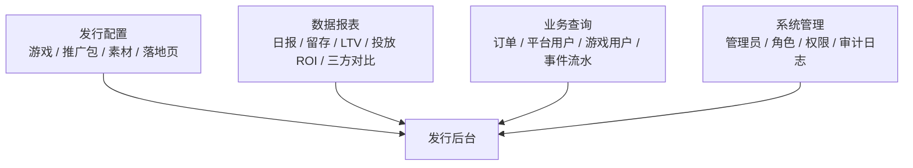
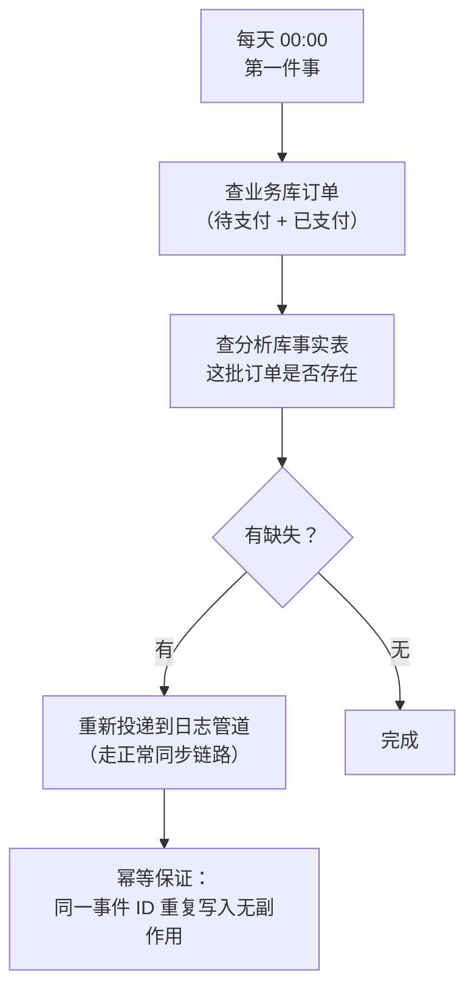

> 系列第五篇。上一篇讲数据怎么算出来（[数据体系](/2026/10/13/game-publish-platform-04-data-system.html)），这一篇讲**人怎么用**：运营、投放、客服每天实际在哪个界面上干活。
>
> 依然四段：**业务背景 → 方案设计 → 关键取舍 → 真实经验**。

---

## 一、业务背景

### 后台是发行平台的"驾驶舱"

前面几章讲的东西——账号、支付、包、数据——最终都要落在一个后台界面上被人操作：

- 运营：开游戏、配开关、上主包、建推广包、发落地页
- 投放：看各计划的消耗与回收，决定加预算还是停
- 客服：查某个玩家的订单和账号状态
- 管理：分配权限、看谁改了什么

### 核心矛盾

> **一套后台要服务好几种角色，他们的权限、数据范围、关注模块完全不同；但底下的数据和接口只有一套。**

这带来两个必须回答的问题：

1. **功能可见性**：谁能看到哪些菜单、点得动哪些按钮？
2. **数据可见性**：同一个报表，A 运营只能看自己的游戏，B 运营能看全部——这个差别在哪一层实现？

还有一个容易被忽略的前提：**后台是内部系统，但它改的是线上数据**。一次误操作（关掉某游戏的支付、改错支付配置）就是线上事故。所以后台的"权限"和"审计"不是管理需求，是安全需求。

---

## 二、方案设计

### 2.1 功能地图：按角色切，而不是按技术切

后台模块按"谁在用"组织：



- **发行配置**：运营的主战场，对应第二、三章讲的那些对象
- **数据报表**：投放的主战场，对应第四章的数据体系
- **业务查询**：客服的主战场。订单、平台用户、游戏用户、激活/登录/创角事件流水——**这一类页面看起来最"没技术含量"，但客服的响应速度全靠它们**
- **系统管理**：权限和审计，下面单独讲

### 2.2 权限模型：三层结构，只有第三层是真权限

权限设计成三层：

| 层级 | 内容 | 是否可分配 |
|---|---|---|
| 第一层 | 模块 / 集合 | 否（仅用于组织） |
| 第二层 | 页面 / 资源 | 否（仅用于组织） |
| 第三层 | **动作** | **是——这才是真正的权限** |

为什么前两层不给分配？因为"能进这个页面"本身没有意义——有意义的是"能在这个页面里做什么"（查看、创建、修改、导出）。

所以：

- 登录后返回的**扁平权限清单里只有第三层动作**
- 菜单树由第一、二层派生，但**只有用户在该页面下拥有至少一个动作权限时，这个菜单才显示**

第二条是经验性的修正。早期的实现是"有页面权限就显示菜单"，结果是：用户看得见菜单、点进去 403——**这种"看得见进不去"的体验，比菜单不显示更让人困惑，还会产生"系统坏了"的反馈。**

### 2.3 权限名从路由自动派生

动作权限的命名不手工登记，而是**从后台路由自动派生**：

```
/{资源}:{动作}
```

比如一个推广包列表接口，对应的权限名就是 `资源:list`；创建就是 `资源:create`。

**好处是"约定优于配置"**：新增一个接口，权限名自动就有，不需要同步维护一份权限清单；权限清单和接口永远对得上，不会出现"接口有了但权限忘了加"。

**代价必须记住**：路由即权限名。**改路由 = 改权限名**，而生产环境的权限数据是人工维护的——所以调整路由前，必须先把角色上的旧权限迁移掉，否则部署完线上直接 403。

这不是理论风险，是实际发生过的部署事故（后面"真实经验"里展开）。

另外，共享的选项类接口（多个页面共用的筛选下拉数据）保留**兼容别名**——同一个选项接口可以被多个页面的权限名访问。**这类"小妥协"是必要的**，否则要么复制接口，要么把权限颗粒度搞乱。

### 2.4 数据范围：和权限是两个问题

这是后台设计里最值得单独说清楚的一层：

> **动作权限回答"能不能调这个接口"，数据范围回答"能看/能改哪些游戏和推广包"。**

两者是正交的：

- 有"看报表"的权限，但没被授权任何游戏 → 报表能打开，数据是空的
- 有"改游戏配置"的权限，但只被授权了 3 个游戏 → 只能改这 3 个

实现上是两张授权表：管理员 ↔ 游戏、管理员 ↔ 推广包。三条规则：

1. **继承**：授权一个主游戏，自动可见它下面的子游戏（层级继承）——因为实际业务里游戏是树状结构（主游戏 → 各平台子游戏）
2. **角色级覆盖**：特定角色可以带"全游戏""全推广包"标记，直接放开
3. **超管绕过**：系统管理员不受权限和数据范围约束（但要接受审计）

**把数据范围独立成一层，而不是塞进权限模型里**，好处是两边都可以单独演进：权限体系继续按"动作"细化，数据范围继续按"游戏/推广包"扩展，互不干扰。

### 2.5 对账：每天的第一件事

数据管道是异步的（业务库 → 日志表 → 队列 → 分析库事实表），**任何一环都可能丢数据**：进程崩了、队列堆积、同步延迟。

对"收入"这种数据来说，丢一笔就是错。所以设计了一个**每日订单对账任务**：



三个设计要点：

**① 顺序是设计的一部分**

对账排在 00:00，**必须在留存计算（凌晨）和 LTV 计算之前**。因为留存和 LTV 都依赖完整的订单数据——**如果对账排在分析任务后面，那这一天的报表就是建立在残缺数据上的，而且它不会报错，数字只是偏低。** 这种"安静的错误"最难发现。

**② 修复方式不是直接写目标表，而是"重走正常链路"**

发现缺失后，不是直接往分析库里补一行，而是**把订单重新投递到日志管道**，让它走和其他数据完全一样的同步路径。

为什么？因为直接写目标表意味着**两条写入路径**，将来任何一条路径的字段口径变了，就会出现"正常写入的数据和对账补的数据长得不一样"。**修复走主链路，是数据一致性的基本纪律。**

**③ 幂等是前提**

重发必须安全，所以日志管道有唯一事件 ID + upsert 语义：**重复投递不会产生重复数据**。没有这个前提，对账任务本身就成了风险源。

另外，对账命令支持 `dry-run`（只报告不修改）和按日期回补（历史数据也能修）——**"能安全地重放"，是这类补偿任务最重要的工程属性。**

### 2.6 审计日志：内部系统也要留痕

所有后台操作统一记审计日志：操作路由、请求参数、操作人、IP、User-Agent、响应状态码。

关键在于**用中间件统一记录，而不是靠业务代码自觉**：

- 业务代码写日志，一定会漏（新接口忘了写、异常分支没覆盖）
- 中间件挂在路由层，**新增接口自动被覆盖**，不需要任何额外工作

**审计日志的价值只在出事的时候体现**：某个游戏支付被关了一天，第一个问题永远是"谁在什么时候改的"。**如果系统答不出来，那这个系统就没有可治理性。**

### 2.7 事件查询页：把事实表变成可检索的

客服和运营最常用的页面之一，是各类事件流水查询：激活事件、登录事件、创角事件、订单。

这些页面直接读分析库的事实表（明细），但**展示字段用权威表覆盖**：

- 事实行提供"发生了什么"（时间、设备、归因、金额）
- 权威表提供"现在长什么样"（角色名、等级、VIP——这些会变，事实行里存的是当时的值）

这就是上一章"**明细用于分析、权威用于判定**"那条原则在界面上的落地。

### 2.8 三方数据对比

发行经常要同时看"我们算的数据"和"合作方/渠道算的数据"。

做法是把合作方的产品列表和每日报表同步进来（按产品维度、渠道维度两种粒度），做成一个对比报表页：

- 支持按日期范围、产品、渠道筛选
- 支持"按渠道分组 / 按产品分组"切换
- 第一页带一行**汇总行**（所有指标求和），方便先看总量再看结构

**这个页面的真正用途不是"看数据"，是"找差异"**：两边数字差得多的地方，就是归因、口径或结算需要核对的地方。

---

## 三、关键取舍

| 决策 | 选择 | 放弃的方案 | 理由 |
|---|---|---|---|
| **权限模型** | 自建三层动作模型 | 直接用现成 RBAC 包 | 需要"路由派生 + 数据范围"两层绑定，现成包改造成本更高 |
| **权限命名** | 从路由自动派生 | 手工登记权限清单 | 接口与权限永远对得上；代价是改路由要同步权限数据 |
| **菜单可见性** | 有动作权限才显示 | 有页面权限就显示 | 避免"看得见、点不进"的 403 体验 |
| **数据范围** | 独立一层（游戏 / 推广包授权） | 并入权限模型 | 两个正交问题，混在一起两边都无法独立演进 |
| **范围继承** | 主游戏授权自动继承子游戏 | 逐个游戏授权 | 游戏天然是树，逐个授权会漏、会累 |
| **审计日志** | 中间件统一记录 | 业务代码各自记录 | 业务代码一定会漏；中间件自动覆盖新接口 |
| **数据一致性** | 每日对账 + 重走主链路 | 直接补写目标表 | 双写路径会导致口径分叉；修复必须走同一条路 |
| **配置表删除** | 不提供删除，只可停用 | 软删除 / 物理删除 | 推广包是历史归因和订单的锚点，删了就断链 |
| **对账时机** | 分析任务之前（00:00 第一位） | 任意时间 | 顺序错了，报表会安静地算错 |
| **权限数据维护** | 生产手工维护 | 随代码发布自动同步 | 生产权限数据是业务资产，不能跟着部署被覆盖（代价：删路由要先改数据） |

---

## 四、真实经验

### 1. 菜单能看见，点进去 403

权限体系上线后收到过"系统坏了"的反馈：菜单在，点进去报无权限。

根因：菜单树从页面节点派生，而页面节点不是真权限——**用户的角色里有页面节点，但没有任何一个动作权限**。

修法就是前面说的：**菜单可见性由"该页面下是否有任意动作权限"决定**。

**这个 bug 的教训是通用的：可见性和可操作性必须由同一个判据驱动。** 只要两者用了不同的数据源，就一定会出现"看得见但用不了"或者"能用但看不见"。

### 2. 改路由名，等于改权限名

权限名从路由派生，所以一次"看起来很安全"的路由重命名（比如把两个报表接口合并成一个），上线后相关角色的权限全部失效——因为权限名从旧 URI 派生，新 URI 派生出的权限名在角色数据里不存在。

修法有两步：

1. 部署前先把生产角色数据从旧权限迁到新权限
2. 共享的选项类接口保留兼容别名，避免多个页面互相牵连

**"权限数据手工维护"这个选择的代价就在这里。** 它不是缺陷，是权衡：换来的是"部署不会覆盖生产权限配置"。**但代价必须写进部署清单，否则每次动路由都要重新踩一遍。**

### 3. 数据范围问题会被误判成权限问题

客服反馈"订单查不到"，第一反应是权限配错了。实际是：**动作权限有，但该管理员没有被授权这个游戏的订单范围。**

这两类问题的排查路径完全不同：

- 权限问题 → 查角色 → 查动作权限
- 范围问题 → 查该管理员的游戏 / 推广包授权

**报错信息如果只有一句"无权限"，就会把所有排查都导向错误的方向。** 后来在报错里区分了"缺少动作权限"和"缺少数据范围"，排查效率立刻提升。

### 4. 对账任务必须排在分析任务前面

这个教训是"设计顺序"的价值：对账任务本身很简单（查差异、重发），但**它的执行时间点决定了当天所有分析数据的质量**。

当时的排期是：00:00 对账 → 凌晨留存计算 → LTV 计算。为什么对账要第一个跑？因为后面两个都读订单事实数据——**对账补进来的数据，必须能被当天的计算看到。**

如果反过来，缺失的订单要到第二天才会进入留存/LTV 的口径，而这两张报表都是"按注册日期分群"的——**补数据的时间差会直接导致两天的数字都不对。**

### 5. 配置表不提供删除

推广包这类配置记录，最终把删除功能整个去掉了（前后端都不再提供删除），改为只允许停用。

原因：**推广包是历史数据的锚点**。订单、事件、归因都引用推广包 ID——一旦删掉，"上个月那批订单是哪个计划带来的"就永远无法回答了。

**配置类数据的生命周期，通常比创建它的人想象的长得多。** 判断一张表能不能删，标准不是"还有没有人用它"，而是"将来还要不要解释历史"。

### 6. 后台的每一次点击都是线上操作

最后一条件值得写在这里：后台页面看起来是"内部工具"，但"关闭游戏支付开关"和"发布一次线上变更"是同一件事。

所以后台的设计标准应该向生产系统看齐：**权限分层、数据范围、操作审计、危险操作二次确认，一个都不能省。**

---

## 下一篇

**（六）稳定性与运维**：双机部署、全量日志、监控告警、降级策略与成本规划——这套系统怎么在无人值守的夜里保持可用。

---

*本文基于实际项目整理，已脱敏。文中不含任何公司业务数据、配置或凭据。*
