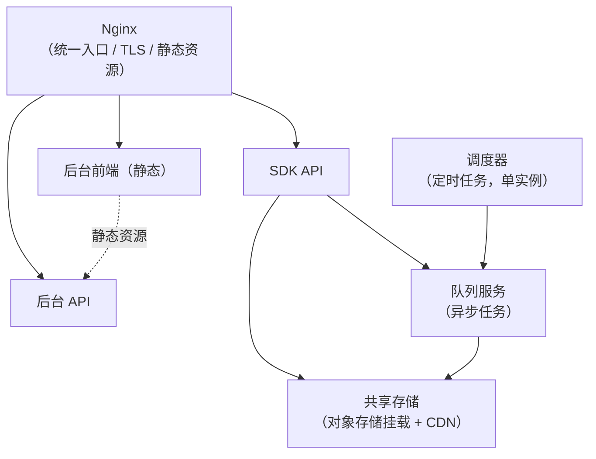

> 系列第六篇。上一篇讲后台（[发行后台](/2026/10/13/game-publish-platform-05-admin-console.html)），这一篇讲这套系统**怎么在无人值守的夜里保持可用**。
>
> 依然四段：**业务背景 → 方案设计 → 关键取舍 → 真实经验**。

---

## 一、业务背景

### 这是一个 7×24 无人值守的系统

发行平台的负载有几个特点：

- **玩家随时在登录、支付**：SDK 接口挂了，所有接入的游戏一起受影响
- **广告平台的回传不挑时间**：点击、转化回调随时到达，处理不过来就是丢归因
- **凌晨是最忙的时候**：对账、留存、LTV 全部排在夜里跑，天亮前必须算完

而团队规模很小——**没有专职运维**。

### 核心矛盾

> **系统必须自己扛住夜里的异常；但"自己扛住"的前提是"出事了有人能第一时间知道，并且定位到原因"。**

"能扛"和"能定位"是两件事，很多小团队只做了前一半：加了重试、加了兜底，但出问题时面对一堆没有上下文的日志，排查时间比修复时间还长。

所以这一章的内容分三层：**部署形态**（怎么部署才能既省钱又能扩）、**可观测性**（出问题怎么定位）、**故障处理**（怎么让异常不变成事故）。

---

## 二、方案设计

### 2.1 部署形态：四个服务，一个有状态

服务按职责拆成四个：



**① 调度器必须单独部署，而且只有一个实例**

定时任务（对账、报表重算、分包调度）如果跟着 API 一起扩容，就会变成 N 个实例同时执行同一个任务——**对账重发、报表重算这类任务会被重复触发**。

所以调度器是唯一"不能伸缩"的服务，单独一台，只跑 `schedule:run`。

**② 其余服务共享同一套实例模板和伸缩组**

SDK API、队列、后台 API 用同一个镜像模板，只是启动不同的进程。好处是**扩容时不用为每个服务单独维护一套部署配置**——这在没有专职运维的团队里非常重要。

**③ 用常驻内存的方式跑 PHP，而不是"每请求启动框架"**

传统 PHP 的执行模型是每个请求重新加载框架（几百毫秒的开销），我们用**常驻内存的应用服务器**（Octane 类方案）把框架加载一次、请求复用。

配套的关键参数是 **worker 最大请求数**：每个 worker 处理 N 个请求后自动回收重启（SDK 接口配 1000，后台接口配 500）。

为什么？因为常驻内存的代价是**内存泄漏会累积**——单次泄漏几十 KB 看不出来，跑一天就变成几百 MB。**用"定期回收"把泄漏的影响面控制在一个可控窗口内，是常驻内存方案的标准护栏。**

**④ 资源配额是主动压过的**

单机 4C4G 的机器上，给单个服务限定 1.5G 内存、1.5 核 CPU——**故意留出余量让多个服务跑在同一台机器上**。这是成本设计：小团队的业务量下，机器数量比单机性能更值得优化。

### 2.2 日志：集中化，按主机隔离

多实例部署有一个天然问题：**实例会被销毁和重建，本地日志随之消失**。

方案是三层：

1. **日志写到集中存储**（网络文件系统挂载），不依赖实例本地盘
2. **按主机名分目录**：每个实例写自己的目录，**避免多实例同时写同一个文件**——这是集中日志最容易踩的坑（两个实例交叉写同一个日志文件，内容会互相截断）
3. **由日志采集器统一上报到日志平台**，按主机名归档

目录结构按服务分开（API 日志、队列日志、调度器日志、Nginx 日志各一个目录），这样排查问题时"先定位服务，再定位实例"。

另外，**文件上传目录直接挂对象存储**（而不是存本地盘），对外通过 CDN 分发：

- 实例是无状态的，**扩缩容不丢文件**
- 大文件（安装包）不占服务器磁盘
- CDN 承接下载流量，回源压力小

**这一条其实是分包和落地页能成立的基础**：包和落地页文件都在对象存储 + CDN 上，服务端只负责生成和记录。

### 2.3 全链路追踪：一个 request_id 串起所有日志

对 API 类业务，**日志是唯一的"案发现场"**——请求处理完就什么都不剩了，出了问题只能靠日志还原。

但日志多起来之后，新的问题出现了：**同一条日志在哪个请求里？**

所以每个请求进来时生成一个 `request_id`（UUID），并且三处都带上：

- **响应体**（客户端可以拿到，报障时能提供）
- **响应头**（便于抓包和网关层记录）
- **所有日志行**（这是核心）

排查时的体验完全不同：

- 没有 request_id：在几万行日志里按时间戳和关键词猜
- 有 request_id：**一次检索，这个请求经过的每一层（网关、验签、业务、SQL、队列）全部串起来**

中间件链的顺序也是设计过的：

```
request_id → 审计 → 验签 → SQL 审计 → 限流
```

request_id 排第一，因为它要覆盖后面所有环节——**包括那些被拒绝的请求**（验签失败、限流命中）。**"失败的请求"恰恰是最需要追踪的请求。**

### 2.4 限流：按场景配置，按 API 家族定契约

限流分场景设计，因为不同接口的风险完全不同：

| 场景 | 维度 | 目的 |
|---|---|---|
| 短信发送 | 按手机号 + 按 IP 双维度 | **防刷短信**——短信是真金白银的成本 |
| 登录换 token | 通用频控 | 防暴力尝试 |

两个设计细节：

**① 精确信息要放在最接近判定的地方**

"手机号超限"和"IP 超限"对客户端是两种不同的处理（前者提示用户稍后重试，后者可能是网络环境问题）。能区分这两者的只有**命名限流器本身**——全局异常处理器拿到的是一个笼统的"限流异常"。

所以命名限流器各自返回精确的错误码，全局处理器只做兜底。

**② 不同 API 家族用不同的响应契约**

- **SDK 接口**：返回 HTTP 200 + 业务码（客户端逻辑统一按业务码处理，不依赖 HTTP 状态）
- **后台接口**：返回 HTTP 429 + JSON（后台是标准 Web 应用，状态码语义有意义）

**这是刻意的契约选择，不是"Laravel 默认行为漏出来了"。** 关键是把选择写清楚，而不是让两套行为随机并存。

### 2.5 健康检查：端口活着不等于服务正常

最基础的监控是"进程还在吗"，但这远远不够：**进程活着、端口能连，不代表接口是对的**（可能某个依赖挂了、某个配置错了）。

所以健康检查做在**接口契约层**：用 OpenAPI 契约驱动测试工具，自动生成请求、校验响应是否符合契约。

工具选择上还有一个教训：原本考虑的 Dredd 已经停止维护了，换成了活跃维护的替代品。**监控和测试工具本身也需要被维护，"选一个已经归档的工具"等于给自己埋了一个定时炸弹。**

### 2.6 故障处理：重试、补偿、隔离

**① 重试：发货通知**

支付成功后要通知游戏服发货。这个通知可能失败（游戏服重启、网络抖动），所以：

- 通知地址支持**订单级指定**，没指定就回落到游戏默认地址（兼容 + 灵活）
- 订单上记录**重试次数**，失败可以重试

**② 补偿：定时对账**

第五章讲过的每日订单对账，从稳定性角度看就是**补偿机制**：承认异步管道会丢数据，用定时任务把差异找回来。

**③ 隔离：一个游戏的问题不影响其他游戏**

这条贯穿前面几章：

- 支付路由按游戏配置 → 一个游戏支付出问题不波及其他游戏
- 推广包按子游戏隔离 → 一个包的配置错误不影响其他包
- 队列任务按游戏分片处理 → 一个游戏的异常任务不会阻塞队列

**隔离是"故障不扩散"的前提，而它必须在设计时就做进去**——事后补隔离，通常意味着重构。

### 2.7 成本：优化的顺序不能反

成本优化有一个顺序问题，顺序错了就是白干：

1. **架构选择**（最大的杠杆）：常驻内存模型让单机吞吐上一个台阶；分析负载挪到独立分析库，业务库不再被报表拖累；大文件走对象存储 + CDN，不占服务器磁盘
2. **资源配额**（中等杠杆）：单服务限内存、限 CPU，让多服务同机共存
3. **实例数量**（最后的杠杆）：扩缩容策略

**先砍配置、后想架构，是最常见的错误顺序**——配置砍下去，性能问题会以"偶发超时"的形式回来，排查成本远超省下的钱。

---

## 三、关键取舍

| 决策 | 选择 | 放弃的方案 | 理由 |
|---|---|---|---|
| **调度器部署** | 独立单实例 | 与 API 混部并随伸缩组扩容 | 定时任务多实例执行会重复触发（对账重发、报表重算） |
| **PHP 运行模式** | 常驻内存 | 传统每请求启动 | 单机吞吐显著提升；代价是必须配 worker 定期回收 |
| **worker 回收** | 处理 N 个请求后重启 | 常驻不回收 | 内存泄漏会累积，定期回收把影响面限制在窗口内 |
| **日志存储** | 集中存储 + 按主机分目录 | 各实例写本地盘 | 实例会被销毁；集中存储避免日志丢失，分目录避免交叉写 |
| **日志上报** | 采集器统一上报 | 各服务自己对接日志平台 | 采集层统一升级维护，业务无感 |
| **大文件** | 对象存储 + CDN | 服务器本地磁盘 | 实例无状态、扩缩容不丢文件、下载流量不占服务器 |
| **追踪** | request_id 全链路 | 只靠时间戳 + 关键词 | 日志是唯一案发现场，没有 request_id 就无法把一次请求串起来 |
| **限流契约** | SDK 用 200 + 业务码；后台用 429 | 全局统一一种 | 两类客户端语义不同，契约差异是刻意选择而非默认泄漏 |
| **健康检查** | 接口契约测试 | 只探测端口存活 | 进程活着不等于接口正确 |
| **成本优化顺序** | 架构 → 配额 → 实例数 | 先砍配置 | 先砍配置会把问题变成难排查的偶发超时 |

---

## 四、真实经验

### 1. 报错说"内存耗尽"，根因是容器循环依赖

后台两个接口（推广包列表、游戏列表）突然开始报致命错误：PHP 内存耗尽，512MB 上限被打满。

错误栈指向的是**框架容器文件**，而且行号每次都不一样——这个特征本身就是线索：**行号不固定，说明是递归，不是某一行代码有问题。**

最终定位：两个 Service 互相注入（A 的构造函数依赖 B，B 的构造函数依赖 A），容器解析时陷入无限递归，**每一次递归都在申请新对象，直到内存耗尽**。

修复方式是在其中一个方向上改为延迟获取（用到时才从容器拿），打破构造期的循环。

**这条经验的价值在于"报错层级"**：容器、序列化、ORM 这类基础设施层的错误，报出来的信息往往和真实原因不在同一层。**看到"内存不够"，第一反应不该是"加内存"，而是"谁在无限地创建对象"。**

### 2. 缓存要缓存数据，不要缓存模型对象

上面那个事故还有一个次要因素：新加的缓存方法**缓存了完整的 ORM 模型对象**。

模型对象带着关系、访问器、全局作用域等一堆内部引用，序列化后体积远大于几个字段。缓存命中的时候还要反序列化，性能收益也被吃掉一部分。

改法是只缓存需要的字段数组。**缓存的原则是"缓存数据，不缓存对象"——对象里有什么，你并不完全知道。**

### 3. 配置读错路径不会报错，只会默默用默认值

限流功能的配置一直"看起来生效"，直到有一次要调短信频次，改了配置发现没反应。

原因：代码读取的配置路径和实际写入的路径不一致，**读取失败后走了硬编码的兜底值**——所以限流一直在用默认的 5 次/小时和 20 次/小时。

**这类"静默降级"是最危险的一类 bug**：功能正常、日志正常、没有任何异常，只是参数不是你配的那个。**凡是"读配置 + 有兜底默认值"的写法，都应该在启动或测试里断言"配置确实被读到了"。**

### 4. 中间件短路会跳过响应装饰

前面提过一次，这里补上原因：request_id 中间件是在**调用后续处理链之后**才往响应上写请求头。而限流命中时，请求被提前中断，后续链条根本没执行——**响应头里的 request_id 就丢了**。

结果是最需要追踪的那类请求（被限流的），反而没有追踪标识。

修法：限流响应自己带上 request_id（从请求属性或请求头里取，取不到就生成一个）。

**通用规律：任何"在响应阶段做加工"的中间件，都要考虑"请求被前面的中间件提前拦截"的情况。**

### 5. 实例会被销毁，日志不能只写本地

伸缩组销毁实例的时候，本地日志一起消失。这在排查"某个时间段偶发失败"时是致命的——**证据随着实例一起没了**。

改成集中存储后，还有一个新坑：多个实例如果写同一个日志文件，内容会互相截断。所以**按主机名分目录是必须的**，不是可选项。

### 6. 端口活着不代表服务正常

健康检查最初只探测端口，结果出现过"监控全绿、接口全挂"的情况（依赖的数据库连不上，进程还活着）。

改成契约测试后，健康检查的语义变成"**接口按约定返回了正确的结构**"，才真正对得上"服务正常"这个判断。

---

## 下一篇

**（七）工程规范与团队协作**：分支管理、代码评审、发布流程、文档标准、任务拆分——前面六章讲的是"系统怎么设计"，这一章讲"**这套系统是怎么被一群人（和 AI）持续改对的**"。

---

*本文基于实际项目整理，已脱敏。文中不含任何公司业务数据、配置或凭据。*
