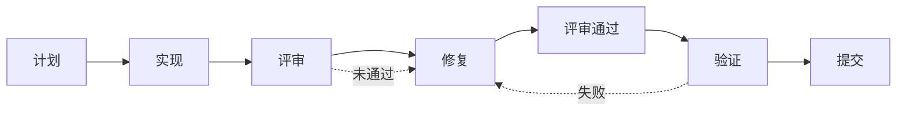
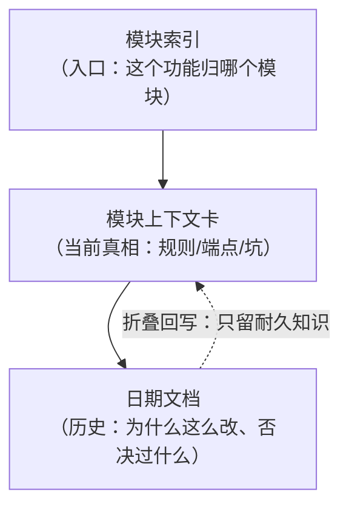

> 系列第七篇。前面六章讲的是"系统怎么设计"（[上一篇：稳定性与运维](/2026/10/13/game-publish-platform-06-stability-ops.html)），这一章讲**这套系统是怎么被持续改对的**——尤其是当编码的主要产出方变成了 AI 之后。
>
> 依然四段：**业务背景 → 方案设计 → 关键取舍 → 真实经验**。

---

## 一、业务背景

### 写代码不再是瓶颈，"改对"才是

这套系统有一个不太常规的特点：**代码量远大于团队规模**。

原因很直接——大量编码工作由 AI 承担。这带来一个结构性变化：

- 过去：写代码慢，所以"想清楚再写"是自然约束
- 现在：**写代码很快，所以"想清楚"和"验证"成了唯一的瓶颈**

如果没有配套的规范，AI 提效会直接转化成两类风险：

1. **改错但看不出来**：代码读起来合理、能跑、测试没覆盖到，问题留到线上
2. **改对但不敢改**：没人敢动一个"不知道边界在哪"的模块，提效反而变成维护恐惧

### 核心矛盾

> **速度来自"让 AI 大胆改"，安全来自"每一步都可验证"。两者必须同时成立——只有速度会失控，只有安全会停摆。**

这一章的所有设计，都是在给"快速改动"配一套**可验证的护栏**。

---

## 二、方案设计

### 2.1 研发流程：把"评审"设成提交闸门

流程是固定的七步：

配套三条硬规则：

**① 评审是闸门，不是建议**

> 未评审的代码不允许提交。

这一条要写成规则而不是习惯，因为它反直觉：AI 产出代码的速度让人本能地想"先提交、回头再看"——**但"回头"通常不会发生**，而且改动会持续叠加在未评审的基础上。

**② 证明，而不是声称**

不允许"我改好了"这种结论。要求是**跑测试、跑构建，并把输出贴出来**。

对 AI 协作者来说这一条尤其重要：AI 非常擅长生成"看起来对"的说明，而**只有执行输出是它无法编造的**。

**③ 先计划，再写码**

多步改动必须先说清意图（改哪些文件、为什么、怎么验证），再动手。

原因：**计划阶段发现的问题，修改成本是零；实现之后才发现方向错了，成本是全部返工。**

### 2.2 动手前的核对：Pre-Action Gate

在改任何既有逻辑之前，有四步固定动作：

1. **读文件**——不假设内容（"我以为它长这样"是错误的高发区）
2. **搜调用方**——改这个函数，谁在依赖它
3. **核对**——"需求里说的"和"代码里实际是"是否一致
4. **不一致就立刻上报**，不允许静默选一个

第 4 条值得展开，因为它是最容易被"好心"违反的一条：

> 当"用户/需求说的"和"代码里的实现"不一致时，AI（或人）的本能是**选一个看起来更合理的继续做**。这是最贵的错误——因为这意味着**改动的基线本身就是错的**，后面所有工作都建立在错误假设上。

正确的做法是把矛盾摆出来，附带判断依据（如果旧实现有测试和文档支撑，可能是需求方记错了；如果旧实现是历史遗留，那需求方的描述可能就是目标）。**把判断权交回给最有上下文的人。**

另外，**破坏性操作**（删除、重命名、改表结构）要额外走一次安全检查——这类操作不可逆，值得多花一分钟确认。

### 2.3 规格驱动：每个东西只有一个真相源

"改对"的前提是"知道什么是对的"。所以每个关键产物都有一个**唯一的真相源**：

| 产物 | 真相源 |
|---|---|
| 数据库结构（业务库 + 分析库） | 一份 schema 定义文件 |
| SDK 接口契约 | 一份 OpenAPI 契约文件 |
| 后台权限与菜单 | 一份权限数据样例 |

规则很硬：

- **schema 定义文件是唯一权威**，模块文档只是它的派生摘要
- **接口契约是唯一权威**，实现要对着契约写
- 数据库变更除了迁移文件，还要**汇总到一份变更日志**（新内容追加在最顶部）——因为生产环境的执行要可追溯、可重放

**契约先行的收益在小团队 + AI 协作下被放大**：

- 前后端可以真正并行（契约冻结 = 接口冻结）
- AI 有明确的边界，不需要"猜"接口长什么样
- **评审有依据**——评审时对照的是契约，而不是"我觉得应该这样"

### 2.4 文档体系：模块卡 + 日期文档 + 折叠回写

文档分三层，各司其职：

**① 模块上下文卡（当前真相）**

每个功能模块一张卡，结构固定：

- 元信息：权威引用（指向真相源文件）、相关历史文档、关键词
- 范围：这个模块负责什么、**不负责什么**
- 关键业务规则：可以快速读完的规则清单
- 端点表 / 表字段焦点 / 代码入口
- **常见 bug 向量** ← 这一节最有价值

"常见 bug 向量"不是"怎么用"，而是"**这里曾经怎么错过**"：

- 不要相信请求里传来的参数作为归因依据（要以游戏配置为准）
- 忘了缓存里也会存"未命中"这个结论
- 改了路由就要检查权限名（因为权限名从路由派生）
- 把数据范围问题当成权限问题排查

**这些是踩过的坑的沉淀。** 它的作用是让下一个会话（无论是人还是 AI）**不再重犯同一个错误**——这比任何"使用说明"都值钱。

**② 日期文档（历史）**

每个功能的方案、推演过程、被否决的选项、实施步骤，都留在按日期归档的文档里。

它的定位是**历史，不是当前真相**——所以规则明确：**日期文档与模块卡冲突时，以模块卡和代码为准。**

**③ 折叠回写（fold-back）**

功能上线、验证通过之后，有一个固定动作：**把"耐久知识"从日期文档折叠回模块卡**。

- **折叠什么**：范围与职责、稳定的业务规则、关键表字段、关键端点与流程、代码入口、常见失败模式、重要错误码与不变量
- **留下什么**：长篇推理、被否决的备选方案、分步实施计划、大段 SQL/代码片段

**这一步是文档体系能长期活着的原因**：没有它，模块卡会过期、日期文档会变成唯一入口，最后所有人都在读三个月前的实施计划。

**④ 一条反直觉的写法要求**

文档**不为了限制每行字数而折行**——因为折行会打断句子，而这份文档的首要读者是 AI。

**这个要求本身很说明问题：文档的读者变了，写法也要跟着变。** 人读的是排版，AI 读的是语义完整性。

### 2.5 面向 AI 的协作约定

AI 参与的研发流程，有一个闭环：

> **需求 → 设计数据结构 → 出实现方案 → 编码 → 按方案评审代码 → 测试环境验证 → 上线**

注意其中的**评审方式**：不是"通读一遍代码找问题"，而是**对照实现方案逐条检查"方案里说的，代码里有没有做对"**。

这个区别很重要：通读代码只能发现"看起来不对"的地方，而**对照方案评审能发现"漏做"**——漏做是最难被通读发现的缺陷（因为缺的东西不会跳出来说"我不在"）。

除了流程，还有三条约定写进了仓库：

**① 意图路由表**

把常见意图和对应的处理方式列成表，强制匹配：

| 用户表达 | 处理方式 |
|---|---|
| 报错 / 不工作 / 崩溃 | **先做根因调查**，不直接改代码 |
| 评审 / 检查 | 走评审流程 |
| 发布 / 合并 | 走发布流程 |
| 新功能 / 设计 | **先出方案评审**，再写代码 |

理由写在表头：**"很多模型不会自己推断意图，这张表就是强制执行机制。"**

**② 模型分工**

按任务类型分配模型：**规划和理解用更强的模型，编码用性价比更高的模型。**

原因：规划错了代价最大（返工全量），编码是可以被评审和测试兜住的环节。**把算力花在错误代价最高的地方。**

**③ 规范必须写进仓库，不能只存在人脑里**

这条是上面所有约定的前提：**规范写在人脑里，AI 读不到；写进仓库文件，人和 AI 共用同一套约束。**

### 2.6 分支、提交与发布

**提交信息**用约定式提交（类型 + 范围 + 描述），比如"新增后台订单页""修复归因解析异常""更新依赖"。

**分支模型**简单直接：

- 集成分支作为基线
- 功能分支按 `feature/日期_描述` 命名
- 紧急修复走 `hotfix/日期_描述`
- **合并前先 rebase**（保持线性历史，避免"合并提交淹没真实改动"）

**PR 描述**必须包含：做了什么 / 为什么、关联任务、**测试步骤**、配置变更说明；界面改动附截图；CI 必须通过。

**涉及业务规则的改动**还要额外说明三件事：

1. **规格对齐**：对应哪个规格文件（改了什么契约）
2. **错误码语义**：新增/变更的错误码含义（比如"支付被禁用"对应哪个码）
3. **性能说明**：如果是查询优化，说明合并了哪些重复查询

**这三条不是形式主义**——业务规则的改动是"评审时最需要上下文"的一类改动。

### 2.7 测试：业务规则必须有断言

测试策略按"风险"排优先级，而不是按"覆盖率"：

**最高优先级是业务规则断言**，例如：

- 游戏开关"禁用支付"时，下单接口必须返回**指定的错误码**
- "禁用注册"时，**所有**注册路径必须返回**指定的提示语**
- 初始化接口必须返回客户端需要的所有开关标记

为什么这类测试最重要？因为**它们是"配置驱动行为"的规则**——开关一旦被误改，影响的是全部接入的游戏，而且从代码上完全看不出来。

另外两条实践：

- **测试环境隔离**：多人（多 AI 会话）并行开发时，各自有独立的测试库配置，互不干扰
- **接口契约测试定期跑**（第六章的健康检查）：保证"线上接口仍然符合契约"

### 2.8 把事故变成工具和清单

第六章讲过一个内存耗尽的事故，根因是两个 Service 的构造器循环依赖。

事故修完之后，做了三件"复盘产物"：

1. **一个依赖检查脚本**：能扫描服务间依赖、打印依赖图、给出修复建议
2. **一套依赖管理规则**：优先构造器注入；出现双向依赖时，在其中一个方向改为动态解析；用接口或事件替代双向依赖
3. **一份 AI 代码审查清单**：审查服务类时检查——构造器参数是否都必要、是否存在双向类型提示、能否用接口替代具体类、动态解析是否只用于打破循环

**"教训 → 工具 → 清单"是事故复盘的完整闭环。** 只写一份复盘文档，同样的错误还会再来；变成工具和清单，它才真正被防住。

---

## 三、关键取舍

| 决策 | 选择 | 放弃的方案 | 理由 |
|---|---|---|---|
| **评审时机** | 提交前闸门 | 事后抽查 | AI 产码速度快，事后抽查永远追不上新增量 |
| **验证方式** | 贴测试/构建输出 | 口头说明"已修复" | 只有执行输出无法被编造 |
| **文档结构** | 模块卡（真相）+ 日期文档（历史） | 一份大文档 / 只有日期文档 | 既要"快速进入状态"，又要"可追溯推理过程" |
| **文档内容** | 指文件路径 | 粘贴代码片段 | 片段会漂移，路径不会 |
| **文档读者** | AI 优先（不折行） | 人类排版优先 | 主要读者已变成 AI，语义完整性优先于版面 |
| **规范载体** | 写进仓库文件 | 口头约定 / 存在人脑 | AI 读不到人脑里的规范 |
| **意图识别** | 显式路由表 | 依赖模型自行理解 | 不同模型推断能力差异大，显式表才可靠 |
| **模型分工** | 规划用强模型、编码用性价比模型 | 全流程同一个模型 | 规划错误的返工成本最高，算力要花在刀刃上 |
| **循环依赖** | 脚本检测 + 审查清单 | 靠评审经验发现 | 人和模型都会漏，工具不会 |
| **数据库变更** | 迁移文件 + 汇总变更日志 | 只有迁移文件 | 生产执行要可追溯、可重放 |
| **分支历史** | 合并前 rebase | 保留合并提交 | 线性历史让"这次改了什么"一眼可见 |

---

## 四、真实经验

### 1. 把评审设成闸门之后，返工反而变少了

一开始的直觉是"评审会拖慢速度"，实际数据是相反的：**返工减少的幅度大于评审占用的时间。**

原因在于返工的分布：未评审的改动一旦提交，问题会在"下一个功能开发到一半"的时候暴露——**那时候的修复成本是当时的 N 倍**，因为你已经忘了上下文、而且新代码已经建立在错误基础上。

### 2. "需求说的"和"代码里的"不一致时，静默选择是最贵的错误

预动作核对的第 4 条规则来自实际教训：曾经出现过"需求描述某个开关的行为，代码里是另一个行为"，改动方按需求描述改了——**结果发现需求描述记错了，旧实现是对的**，改出了一次线上问题。

**现在的要求是：发现不一致就停下来上报，把判断依据列出来，让有上下文的人决定。** 这一分钟的成本，能省掉一次回滚。

### 3. 文档写"怎么用"不如写"这里曾经怎么错"

模块卡里最有价值的一节是"常见 bug 向量"。原因很实际：

- "怎么用"这类内容，读代码和契约也能得到，而且更准确
- **"这里曾经怎么错"只有踩过的人知道**，不写下来就必然重犯

**判断一份技术文档值不值钱，就看它有没有写"别人不知道而你知道"的东西。**

### 4. 规范写进仓库，AI 才遵守得到

这条是被迫学会的：一开始很多约定靠口头传达和"大家应该都知道"。AI 加入协作后立刻失效——**AI 不会读心，它只读文件。**

把流程、路由表、审查清单、命名规则全部写进仓库的规范文件之后，人和 AI 的行为才真正对齐。

**顺带的好处是：新人上手也是读同一份文件。**

### 5. 事故要变成工具，不能只变成文档

循环依赖那次事故，如果只写一份复盘文档，下一个 AI 会话（或下一个人）大概率会再犯——因为**没人会在写代码前先去翻三个月的复盘文档**。

变成"一个能跑的检查脚本 + 一份审查清单"之后，它才进入了**每次改动的必经路径**。

**复盘的正确终点不是文档，是工具和清单。**

### 6. 大段代码不要进文档

早期文档里贴了很多代码片段，结果是：代码改了、文档没改，**读文档的人比不读的人错得更离谱**。

现在的规则是：**只写文件路径 + 一句话说明这个文件负责什么**，具体实现永远去读代码。

**文档和代码的边界是：文档负责"为什么"和"在哪里"，代码负责"是什么"。**

---

## 下一篇

**（八）演进路线**：从三方 SDK 过渡到自研的路径规划——这套系统不是一天建成的，最后一章讲"如果重来一次，或者要继续往前走，路怎么走" → [继续阅读](/2026/10/13/game-publish-platform-08-evolution-roadmap.html)

---

*本文基于实际项目整理，已脱敏。文中不含任何公司业务数据、配置或凭据。*
